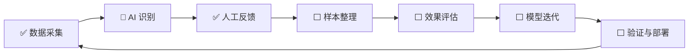

# CatTrace · 猫迹

> 看见每一只猫，守护每一个家。

**面向流浪动物科学救助的开源 AIoT 项目**

CatTrace 探索将计算机视觉、智能终端、边缘计算和数字化平台相结合，为猫咪个体识别、科学 TNR（Trap-Neuter-Return）和社区协同救助提供技术支持。项目当前处于 MVP 阶段，核心 Web 平台已可用，AI 视觉识别模块正在建设中。

---

## 项目愿景与目标

- **猫咪视觉识别与档案管理**：探索通过摄像头采集图像，辅助识别猫咪个体并建立数字化档案。
- **TNR 科学救助辅助**：辅助判断猫咪绝育状态（剪耳标记），为 TNR 决策提供参考信息。
- **智能摄像头与边缘计算**：在树莓派等边缘设备上运行图像采集和推理流程。
- **数据积累与自主学习**：通过人工反馈和数据积累，逐步探索识别模型的持续优化路径。
- **社区协同救助**：提供投喂记录、健康跟踪、领养管理等数字化支持，促进救助信息透明可追溯。

> ⚠️ 本项目中 AI 模型的输出均为辅助参考，不能直接替代人工核验和专业判断。涉及真实救助决策时，不应仅凭未经验证的 AI 结果采取不可逆操作。

## 四大核心能力

### 一、智能视觉识别

CatTrace 的视觉识别流程从摄像头图像采集开始，经过猫脸检测、个体识别和剪耳（绝育）状态识别，最终输出结构化的识别结果。

| 环节 | 当前状态 | 说明 |
|------|---------|------|
| 摄像头图像采集 | ✅ 已实现 | 支持 CSI、USB、RTSP、文件回放、合成数据源五种接入方式 |
| 猫脸检测与个体识别 | ⏳ 占位实现 | 接口协议已定义（`contracts/`），核心识别逻辑待开发，当前使用 Mock 跑通链路 |
| 剪耳（绝育）识别 | 🔶 可运行基线 | `modules/earnotch:EarNotchModel` 已接入 ONNX 模型（整图级二分类 + 左右耳启发式），test acc 0.896；**不是** ROI 分类，见 [docs/earnotch.md](./docs/earnotch.md) |
| 投票聚合与结果稳定 | ✅ 已实现 | 跨帧投票聚合，多数票决定个体身份，避免单帧误判 |

**重要说明**：猫脸检测仍是占位实现，全链路验证（`PIPELINE OK`）默认仍用 Mock 模拟猫脸结果。剪耳模块已有真实模型，但需要猫脸关键点才能裁耳，因此单独跑时用 `--catface mocks:MockCatFaceModule` 提供合法关键点。

### 二、科学 TNR 辅助

TNR（Trap-Neuter-Return）是国际通行的流浪猫科学管理方法。CatTrace 尝试通过技术手段辅助 TNR 流程：

- **剪耳状态判断**（可运行基线）：通过 `modules/earnotch:EarNotchModel` 判断猫咪是否已绝育。当前是用整图训练的过渡模型（test acc 0.896，未绝育误判为已绝育 7.4%），左右耳为启发式判断；接真 ROI 后必须重训并重校阈值，详见 [docs/earnotch.md](./docs/earnotch.md)。
- **猫咪档案管理**：记录每只猫的基本信息、健康数据、绝育状态和互动历史。
- **TNR 决策逻辑**：当系统收到疑似未绝育的识别结果（置信度 ≥ 0.80）时，基于预设规则生成 TNR 任务建议。当前该流程使用 Mock 模拟输入驱动，识别结果不代表真实 AI 判断；系统不能独立作出最终救助决策，所有建议须经人工确认后执行。
- **救助记录追溯**：投喂、举报、医疗等全链路数据透明可追溯。

> ⚠️ 当前 TNR 任务建议完全基于规则引擎和 Mock 模拟输入生成，不涉及真实 AI 识别。系统在置信度不足时不会做出结论，而是保留待人工确认状态。任何 TNR 救助决策均应以现场人工核验和专业判断为准，系统不应被视为独立的决策依据。

### 三、智能设备与边缘计算

CatTrace 的 CatVision 模块设计为在树莓派等边缘设备上运行：

- **多源摄像头接入**：支持 CSI（树莓派官方摄像头）、USB、RTSP、文件回放和合成数据源，对下游统一为 `FramePacket` 接口（"源等价"原则）。
- **帧率控制与内存管理**：固定 2~3 fps 抽帧，帧暂存于内存盘（`/dev/shm`），只保留最近 120 帧。
- **模块化流水线**：采集 → 识别 → 聚合 → 决策 → 事件总线，各环节通过 `contracts/` 接口契约解耦。

**树莓派实测记录**（树莓派 4B，1GB 内存，IMX219 CSI 摄像头）：

| 项目 | 实测结果 |
|------|---------|
| CSI 采集 | 640×480，约 3 fps |
| 合成源全链路（Mock 模型） | `PIPELINE OK`，60 帧约 20 秒 |
| CSI 全链路（Mock 模型） | 10 帧约 9 秒（含预热） |
| 单元测试 | 117 用例全过 |
| ⚠️ 已知问题 | 供电不足（`throttled=0x50005`），需更换 5V/3A 电源 |

> 上述测试使用 Mock 模型输出，不涉及真实 AI 推理。真实模型部署需解决供电问题并验证推理性能。

### 四、自主学习与持续优化

CatTrace 将自主学习与持续优化作为重要的技术发展方向，目标是建立一条从数据采集到模型迭代的完整闭环。

> ⚠️ **以下是当前实现与目标架构相结合的技术路线，不代表完整闭环已经交付。**

#### 目标流程与当前状态

| 环节 | 说明 | 当前状态 |
|------|------|---------|
| **数据采集** | 从摄像头收集图像帧，附带时间戳和来源信息 | ✅ 已实现：`scripts/record_frames.py` 可录制图像序列及元数据 |
| **AI 识别** | 对采集图像进行猫脸检测和个体识别 | 🔶 部分实现：Pipeline 框架就绪，真实模型待开发（当前使用 Mock） |
| **人工反馈与纠错** | 记录人工核验的正确识别结果 | ✅ 已实现：`POST /api/learning/feedback` API + 持久化 |
| **样本整理** | 建立带来源、标签和质量检查的数据集 | 📋 规划中：帧录制工具已有，标注与质量检查流程待建立 |
| **效果评估** | 使用独立测试数据评估模型表现 | 📋 规划中：独立评估体系待建立 |
| **模型迭代** | 根据评估结果进行模型训练或优化 | 📋 规划中：`retrain()` 当前仅执行规则重扫描 |
| **版本验证** | 通过必要测试后再部署新版本 | 📋 规划中：模型版本管理和回滚机制待建立 |
| **部署与回退** | 部署新模型，出现异常时回退到已验证版本 | 📋 规划中：模型部署与回退流程待建立 |

#### 当前已实现的基础能力

- **猫咪行为画像**：基于投喂记录统计每只猫的活跃时段、进食频率和趋势变化。
- **用户行为画像**：分析用户关注偏好、活跃时间和参与程度。
- **异常检测与健康评分**：基于统计规则发现投喂异常，生成 0~100 分的健康评分。
- **反馈记录**：通过 API 记录识别纠错反馈，统计反馈正确率。
- **模块化接口契约**：摄像头、视觉识别、决策和事件存储等环节通过契约解耦。

#### 当前限制

- `SelfLearningEngine` 基于 Python 标准库的统计规则引擎，不等同于机器学习模型。
- `retrain()` 方法执行数据重新加载和规则检测，不是真正的模型训练。
- 尚无完整的数据标注与质量管理流程、独立模型评估体系、模型版本管理或审核发布机制。
- MVP 阶段不进行未经审核的在线深度学习。

详见 [docs/self-learning.md](./docs/self-learning.md)。

---

## 自主学习闭环图示

> 📌 **此图是当前实现与目标架构相结合的路线图，不是完整闭环已经交付的声明。**



| 标记 | 含义 |
|------|------|
| ✅ | 当前已实现 |
| 🔶 | 部分实现（框架就绪，核心待补） |
| ⬜ | 规划中或尚未实现 |

---

## 自主学习技术原则

- **自主学习不是模型无约束地自动修改自身。** 任何规则参数或模型权重的变更，必须经过人工审核后才能生效。
- **人工反馈应经过必要的质量检查。** 不确定或有争议的反馈应标记并单独处理。
- **训练数据和独立测试数据应合理区分，** 避免数据泄漏导致评估失真。
- **模型升级前应进行效果评估和必要验证。** 不采用未经验证的自动模型更新机制。
- **不确定的识别结果允许进入待人工确认状态。** 宁可不做结论，也不要在低置信度时给出错误判断。
- **涉及真实救助决策时，不应仅凭未经验证的 AI 结果采取不可逆操作。**
- **图像和救助记录应考虑隐私、访问权限与数据安全。**

---

## 项目进展

| 能力项 | 状态 | 说明 |
|--------|------|------|
| 摄像头采集（CSI/USB/RTSP/文件/合成） | ✅ 已实现 | 五种数据源均已实现，Pi4 CSI 实测通过 |
| 猫/非猫分类 | 🔶 部分实现 | `models/cat_vs_notcat.onnx` + `CatClassifier` 可用，但只被演示脚本调用，未接入 pipeline |
| 猫脸识别（个体 ID + 关键点） | ⏳ 占位实现 | 接口协议已定义，`modules/catface/` 为占位代码 |
| 剪耳识别（绝育状态） | 🔶 可运行基线 | `modules/earnotch:EarNotchModel` + ONNX 权重；整图级二分类，左右耳为启发式，需猫脸关键点 |
| 投票聚合与结果稳定 | ✅ 已实现 | 跨帧多数票聚合，防抖、多猫拒绝等逻辑完备 |
| TNR 决策逻辑 | ✅ 已实现 | 基于规则引擎生成投粮和 TNR 任务建议，当前使用 Mock 输入驱动 |
| 人工反馈记录 | ✅ 已实现 | 反馈 API + JSON 持久化 |
| 猫咪/用户行为画像 | ✅ 已实现 | 基于统计规则的行为分析和健康评分 |
| 图像帧录制工具 | ✅ 已实现 | `scripts/record_frames.py` 可录制帧序列及元数据 |
| 模型训练（真实 ML） | 📋 规划中 | `retrain()` 当前仅执行规则重扫描 |
| 模型效果评估 | 📋 规划中 | 独立评估体系待建立 |
| 模型版本管理 | 📋 规划中 | 版本记录和回滚机制待建立 |
| 自动化模型更新 | 📋 规划中 | MVP 阶段不做自动模型更新 |
| 树莓派部署 | 🔶 部分实现 | 采集和 Mock 全链路已通过；供电待解决；真实模型待部署 |
| 与 Flask 平台联调 | 📋 规划中 | CatVision 检测事件接入 Web 平台待实现 |

> 状态说明：✅ 已实现 · 🔶 部分实现 · ⏳ 占位实现 · 📋 规划中 · ❓ 待验证

---

## 如何体验项目

### Flask Web 平台（推荐）

```bash
python --version   # 需要 3.6+
pip install -r requirements.txt
python app.py
# 浏览器打开 http://localhost:5000
```

页面路由：`/`（首页直播）、`/cats`（猫咪档案）、`/diary`（日记）、`/adopt`（领养中心）。

### CatVision 全链路验证（无需摄像头）

```bash
pip install -e ".[dev]"
pytest -q
python -m pipeline.runner --source synthetic:60 --mock-all   # 看到 PIPELINE OK 即通过
```

> **当前限制**：`--mock-all` 使用 Mock 猫脸与 Mock 剪耳。剪耳模块已有真实 ONNX 模型，
> 可用 `--catface mocks:MockCatFaceModule --earnotch modules.earnotch:EarNotchModel` 跑真实推理；
> 真实猫脸检测模型仍在开发中，详见 [docs/earnotch.md](./docs/earnotch.md)。

### 五层验证脚本

一条命令自证「摄像头接入 + 模块联调」是否打通（五层验证，逐项 PASS/FAIL）：

```bash
python scripts/verify_catvision.py
```

没有摄像头的开发机 L1~L4 全绿、L5 自动 `[SKIP]`；树莓派插着 CSI 摄像头时 L1~L5 全绿。
判据和实测记录见 [docs/验证指南.md](./docs/验证指南.md)。

### 静态演示页（零依赖）

双击打开 `demo.html`，无需 Python、无需网络。详见 [docs/demo-guide.md](./docs/demo-guide.md)。

---

## 文档索引

### 核心文档

| 文档 | 内容 |
|------|------|
| [docs/user-guide.md](./docs/user-guide.md) | 用户说明书（面向使用者与评审） |
| [docs/api.md](./docs/api.md) | REST API 完整接口文档 |
| [docs/architecture.md](./docs/architecture.md) | 系统架构、模块关系和数据流 |
| [docs/self-learning.md](./docs/self-learning.md) | 自学习模块：目标、边界、数据闭环、评价指标 |
| [docs/earnotch.md](./docs/earnotch.md) | 剪耳识别：模型能力、阈值策略、指标与已知局限 |
| [docs/roadmap.md](./docs/roadmap.md) | P0-P3 路线图与远期规划 |
| [docs/business-plan.md](./docs/business-plan.md) | 市场分析、技术方案、产品范围 |
| [docs/demo-guide.md](./docs/demo-guide.md) | demo.html 静态演示页使用说明 |
| [docs/验证指南.md](./docs/验证指南.md) | 摄像头接入 + 模块联调五层验证说明 |
| [docs/接手流程.md](./docs/接手流程.md) | 新成员必读：环境搭建、分工、PR 流程 |

### 分模块说明

| 文档 | 内容 |
|------|------|
| [docs/modules/monitoring.md](./docs/modules/monitoring.md) | 实时直播与在线巡检 |
| [docs/modules/feeding.md](./docs/modules/feeding.md) | 远程投喂与投喂追溯 |
| [docs/modules/cat-profile.md](./docs/modules/cat-profile.md) | 猫咪档案与个体化救助 |
| [docs/modules/community.md](./docs/modules/community.md) | 社区共治与支撑功能 |

### CatVision 模块文档

| 文档 | 内容 |
|------|------|
| [README-catvision.md](./README-catvision.md) | CatVision 树莓派 AI 识别模块总览 |
| [docs/接口规范.md](./docs/接口规范.md) | 字段级接口说明 |
| [docs/联调checklist.md](./docs/联调checklist.md) | 联调检查表 |
| [docs/验收记录.md](./docs/验收记录.md) | 实测数据与验收记录 |
| [docs/部署.md](./docs/部署.md) | 树莓派环境搭建与故障排查 |
| [docs/camera-selection.md](./docs/camera-selection.md) | 摄像头选型决策 |

---

## 参与项目

无论你是开发者、设计师还是志愿者，都可以通过以下方式参与 CatTrace：

| 方向 | 说明 |
|------|------|
| 摄像头接入与边缘计算 | 完善树莓派部署、优化采集性能、适配更多摄像头型号 |
| 视觉识别与模型评估 | 开发猫脸识别和剪耳识别模型、建立评估基准 |
| 反馈纠错与数据质量管理 | 设计标注流程、建立数据质量检查规范 |
| 自主学习机制研究 | 探索模型迭代策略、版本管理和安全部署流程 |
| 测试、文档与真实场景验证 | 完善测试覆盖、改进文档、组织实地试点 |

详细的开发环境搭建、分工和 PR 流程见 [docs/接手流程.md](./docs/接手流程.md)。

---

## 协作者代码

`collaborators/` 目录保留了各协作者的原始代码和文档，未经修改：

| 目录 | 内容 |
|------|------|
| collaborators/mao-main | 主项目原始版本（含 MeowGuard 时期文档） |
| collaborators/项目猫-MVP | MVP 原型版本（含猫脸识别等实验功能） |

---

CatTrace 项目组 -- [chenglian07/CatTrace](https://github.com/chenglian07/CatTrace)